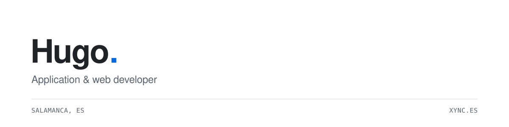
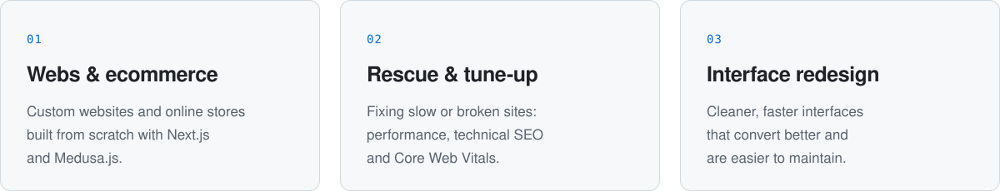
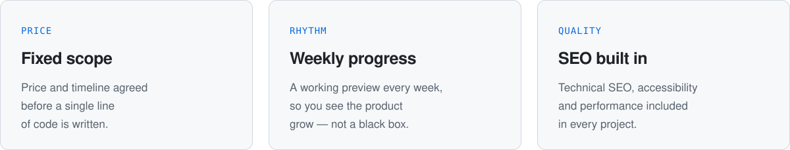

<picture>
  <source media="(prefers-color-scheme: dark)" srcset="assets/header-dark.svg">
  
</picture>

 

I build applications, websites and online stores — from the first sketch to the last deploy.
I care about fast interfaces, clean code and products that feel simple to use.

Currently developing at **[Xync](https://www.xync.es/)**, a web development and design studio based in Salamanca, working with clients across Spain and Latin America.

 

### What I do

<picture>
  <source media="(prefers-color-scheme: dark)" srcset="assets/services-dark.svg">
  
</picture>

 

### Selected work

| Project | Type | Highlights |
| :-- | :-- | :-- |
| **Grieta** | Fashion store | Own online shop to sell without marketplace fees |
| **Cenit** | Fashion ecommerce | Limited-release drop system |
| **Lumen** | Furniture ecommerce | Filterable product catalogue |
| **The Byte** | Digital newspaper | Built for search and fast reading |
| **Lumière** | Restaurant website | Dynamic, easy-to-update menu |

More at <a href="https://www.xync.es/">xync.es</a>

 

### How I work

<picture>
  <source media="(prefers-color-scheme: dark)" srcset="assets/process-dark.svg">
  
</picture>

 

### Stack

 

### Activity

<picture>
  <source media="(prefers-color-scheme: dark)" srcset="https://raw.githubusercontent.com/hugoopr04/hugoopr04/output/activity-dark.svg">
  
</picture>

 

### Get in touch

Have a project in mind — a new website, an online store or a site that needs fixing?
Start the conversation at **[xync.es](https://www.xync.es/)**.

 

© 2026 Hugo · Salamanca, Spain
